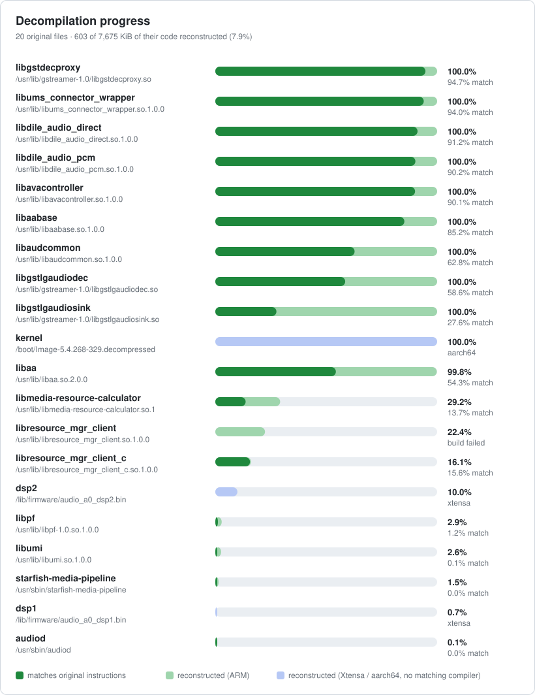

# webos25-audio-decomp

Clean-room decompilation of the LG webOS 25 audio output path, from the media pipeline
down to the eARC output on the DSP. Firmware: LG OLED42C27LA (C2), Rockhopper
10.3.1-3006, kernel 5.4.268-329.ptl4tv.5.

> The original binaries are LG proprietary and are never committed. Git tracks only
> their hashes ([orig/SHA256SUMS](orig/SHA256SUMS)). `src/` is reconstructed C, not LG
> source.



Folder layout and commit rules: [AGENTS.md](AGENTS.md).

## Setup

```sh
make verify        # orig/ holds the expected files (pull them from a rooted TV)
make toolchain     # GCC 11.4.0 ARMv7-A Thumb-2 image, the compiler LG used
make opensource    # optional: LG's GPL/LGPL source into lg-opensource/ (~4.4 GB download)
```

To regenerate `build/decomp/`: Ghidra 12.2 with
`JAVA_HOME=/opt/homebrew/opt/openjdk@21`, and `tools/ghidra-ext/XtensaHiFi` copied into
`~/Library/ghidra/ghidra_12.2_PUBLIC/Extensions/`. Then `make decomp-arm decomp-dsp`.

## Workflow

```sh
make status                          # coverage and instruction match per target
make todo T=libumi                   # largest functions not yet reconstructed
make diff T=libumi F=setOutputType   # instruction diff, original vs compiled src/
make progress                        # regenerate progress.svg above
```

1. Pick a function with `make todo`, read it in `build/decomp/<binary>.c`.
2. Write it in `src/<target>/`, tagged with its Ghidra address on the line before:

   ```c
   /* @0x4fc24: what it does, if not obvious */
   static void setOutputType(struct umi_tv_audio *a, int ct, int mo)
   ```

3. Iterate with `make diff` until the match is as high as it goes.

**Coverage** is the share of a target's function bytes with a reconstruction. **Match**
compiles `src/` with LG's compiler and compares instructions per function (addresses
ignored); 100% is byte-for-byte equivalent. DSP (Xtensa) and kernel (aarch64) targets
report coverage only.

## Addresses

- ARM binaries: Ghidra address = raw ELF VA + 0x10000. Code is Thumb.
- DSP images are linked at 0x60000000.

## Pitfalls

- DSP symbol tables are `(func_ptr, name_ptr)` pairs; literal pools hold look-alikes.
  Confirm a name with `tools/symtab_probe.py` and the function's logged `__func__`.
- Disassemble ARM with `--triple=armv7 --mattr=+thumb-mode`. Plain `thumbv7` crashes
  on barrier instructions.
- Ghidra cannot decode Xtensa FLIX. `tools/xtobjdump.sh dsp2 START END` decodes validated
  branch slots; unresolved SIMD/float slots remain marked `[FLIX]`.
- Ghidra drops the string arguments of `std::string::compare`. Recover them with
  `tools/funcstrings.py`.
